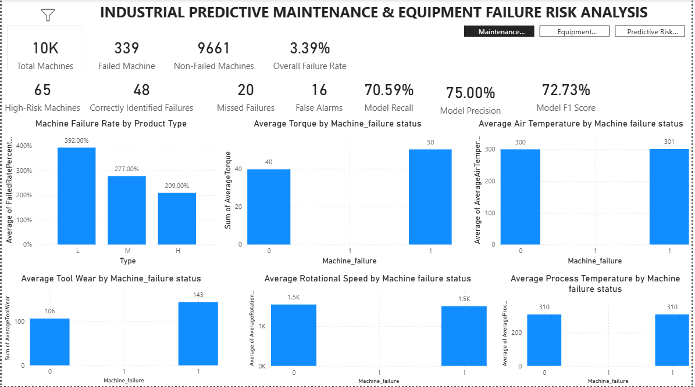
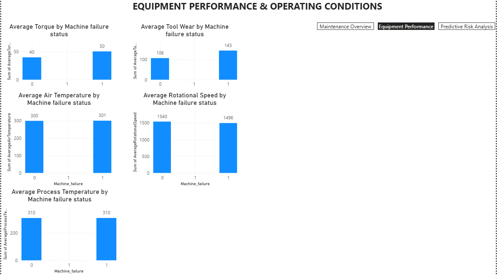
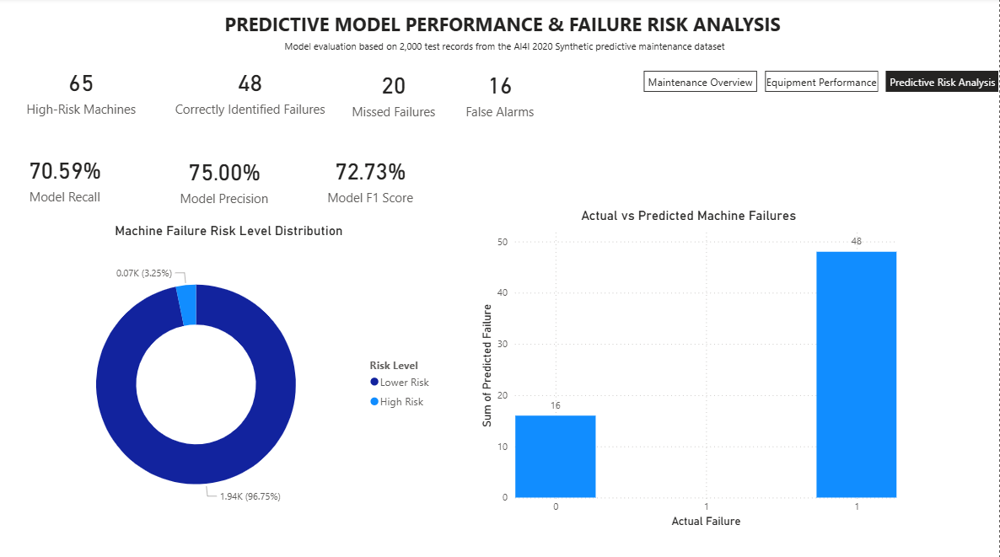

# Industrial Predictive Maintenance & Equipment Failure Risk Analysis System

## Project Overview

This project uses data analytics and machine learning to analyse industrial equipment operating conditions and identify potential machine failure risks.

Using the UCI AI4I 2020 Predictive Maintenance Dataset, the project explores relationships between equipment measurements such as torque, rotational speed, temperature, and tool wear.

The goal is to demonstrate how engineering knowledge, data analysis, SQL, machine learning, and Power BI can support predictive maintenance and improve equipment reliability.

## Project Objectives

- Explore industrial equipment operating data.
- Identify patterns associated with machine failures.
- Develop and evaluate machine learning models.
- Interpret model results from an engineering perspective.
- Perform SQL-based equipment and failure analysis.
- Build an interactive Power BI dashboard.

## Tools & Technologies

- **Python:** Data cleaning, exploratory data analysis, and machine learning.
- **Pandas & NumPy:** Data manipulation and numerical analysis.
- **Matplotlib & Seaborn:** Data visualisation.
- **Scikit-learn:** Machine learning model development and evaluation.
- **Microsoft SQL Server:** Database storage and SQL analysis.
- **Microsoft Power BI:** Interactive dashboard development.
- **Visual Studio Code:** Project development environment.
- **Git & GitHub:** Version control and project documentation.

## Dataset

**Source:** UCI Machine Learning Repository

**Dataset:** AI4I 2020 Predictive Maintenance Dataset

The dataset contains 10,000 synthetic industrial machine records and 14 original columns.

It includes equipment operating measurements such as:

- Air temperature
- Process temperature
- Rotational speed
- Torque
- Tool wear
- Machine failure indicators

**Target variable:** `Machine failure`

The five failure-mode indicators (`TWF`, `HDF`, `PWF`, `OSF`, and `RNF`) were excluded from the model's input features to prevent target leakage.

**Important:** This is a synthetic dataset, not live industrial equipment data.

## Machine Learning Models

Two classification algorithms were developed and evaluated:

1. **Random Forest Classifier**
2. **Logistic Regression**

The Random Forest model achieved the stronger overall balance between precision and recall on the test dataset.

### Random Forest Performance

- Accuracy: 98.2%
- Precision: 75.00%
- Recall: 70.59%
- F1 Score: 72.73%

The model correctly identified 48 of the 68 actual machine failures in the test set.

### Engineering Interpretation

Torque, rotational speed, and tool wear were the most influential features in the Random Forest model.

These findings highlight the importance of monitoring mechanical loading, equipment speed, and tool condition when assessing machine failure risk.

Model results represent performance on a held-out test dataset, not a deployed industrial prediction system.

## Dashboard Preview

### Maintenance Overview

### Equipment Performance

### Predictive Risk Analysis
